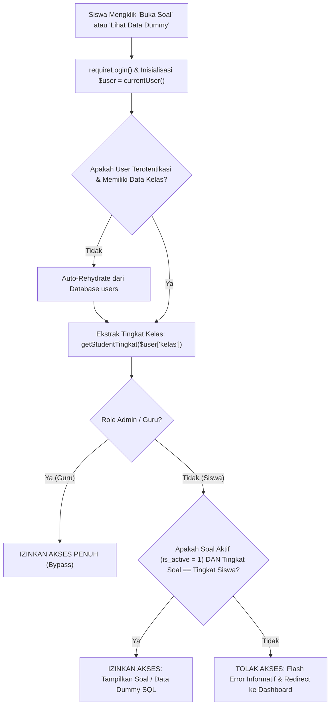

# Rencana Perbaikan: Akses Soal & Data Dummy Siswa Terbuka Sesuai Tingkat Kelas

**Tanggal:** 2026-11-17  
**Status Dokumen:** Selesai Diimplementasikan (Fully Verified)  
**Terkait:** Akses Lembar Kerja Soal (`view_soal.php`) & Data Dummy SQL (`view_sql.php`) Siswa Kelas XI & XII  

---

## 1. Analisis Masalah & Akar Penyebab (Root Cause Analysis)

### Gejala:
Siswa (terutama siswa Kelas XII) tidak dapat membuka naskah soal praktikum (`index.php?page=soal&id=...`) maupun melihat data dummy SQL (`index.php?page=view_sql&id=...`), sekalipun guru penguji telah mengaktifkan (*toggle active*) paket soal tersebut di panel kontrol sesi. Ketika tombol diklik, siswa langsung ditendang kembali ke dashboard dengan pesan peringatan:
> *"Akses ditolak! Soal praktikum tidak tersedia untuk tingkat kelas Anda () atau sedang dinonaktifkan."* (perhatikan kurung kelas tercetak kosong `()`).

### Akar Penyebab Teknis:
1. **Urutan Inisialisasi Variabel `$user` (Scope Undefined Variable):**
   - Pada berkas [src/views/view_soal.php](file:///c:/xampp/htdocs/src/views/view_soal.php#L19-L26) dan [src/views/view_sql.php](file:///c:/xampp/htdocs/src/views/view_sql.php#L17-L24), pengecekan hak akses tingkat kelas siswa dilakukan pada baris 18–26:
     ```php
     if (!isAdmin()) {
         $studentTingkat = getStudentTingkat($user['kelas'] ?? '');
         if (!$soal['is_active'] || $soal['tingkat'] !== $studentTingkat) {
             setFlashMessage('error', 'Akses ditolak!... (' . htmlspecialchars($user['kelas'] ?? '') . ')...');
             header('Location: index.php?page=dashboard');
             exit;
         }
     }
     ```
   - Namun, variabel `$user` **belum pernah diinisialisasi** sebelum baris tersebut! Variabel `$user = currentUser();` sebelumnya hanya dimuat di dalam berkas [src/views/layout_header.php](file:///c:/xampp/htdocs/src/views/layout_header.php#L4), padahal `layout_header.php` baru di-`require_once` di **baris 27/29** (setelah pengecekan hak akses dieksekusi).
   - Akibatnya, pada saat pengecekan izin akses, `$user` bernilai `null`.
   - `$user['kelas'] ?? ''` menghasilkan string kosong `''`.
   - Fungsi `getStudentTingkat('')` secara *fallback* mengembalikan `'XI'`.
   - Bagi seluruh siswa Kelas XII (yang saat ini merupakan 90% dari populasi siswa yang login di lab), perbandingan `$soal['tingkat'] !== $studentTingkat` (`'XII' !== 'XI'`) selalu bernilai **TRUE (Akses Ditolak)**!
   - Siswa kelas XII secara keliru dideteksi sebagai bukan kelas XII dan langsung diusir keluar ke dashboard.
2. **Dampak Ikutan di `view_soal.php`:**
   - Karena `$studentTingkat` salah terhitung sebagai `'XI'`, switcher paket soal lain di sisi navigasi soal (`$stmtOther`) hanya memunculkan soal-soal Kelas XI.
   - Pengecekan riwayat pengumpulan siswa (`':uid' => $user['id']`) mengeksekusi nilai `null`, sehingga siswa yang sudah mengumpulkan jawaban tidak dapat melihat riwayat pengumpulannya di lembar soal.
   - Pengguna/penguji sempat mencoba mengomentari baris 21–25 di `view_soal.php`, namun di `view_sql.php` blok pengecekan tersebut masih aktif sehingga akses ke data dummy SQL tetap terblokir total.

---

## 2. Ruang Lingkup & Kebutuhan Sistem

- **Platform:** Apache / PHP 8.2+ (XAMPP / PHP Built-in Server `0.0.0.0:8080`)
- **Database:** MariaDB / MySQL `db_lab_praktikum`
- **Berkas yang Dimodifikasi:**
  1. `src/helpers/auth.php`:
     - Tambahkan auto-rehydration pada `currentUser()` untuk memastikan data `kelas`, `nama`, dan `nis` otomatis dimuat ulang dari database jika ada sesi browser lama yang tidak memiliki field `kelas`.
     - Perkuat fleksibilitas `getStudentTingkat()` untuk mengenali variasi penulisan tingkat kelas ('XII', 'XI', '12', '11').
  2. `src/views/view_soal.php`:
     - Tambahkan inisialisasi eksplisit `$user = currentUser();` tepat setelah `requireLogin()`.
     - Aktifkan kembali (*uncomment*) dan rapikan guard validasi tingkat kelas & status aktif.
     - Pastikan query switcher soal lain dan status pengumpulan berjalan dengan `$user['id']` yang valid.
  3. `src/views/view_sql.php`:
     - Tambahkan `requireLogin();` dan `$user = currentUser();` di baris teratas sebelum pengecekan izin akses.
     - Pastikan siswa kelas XI hanya membuka data dummy XI, dan siswa kelas XII hanya membuka data dummy XII yang berstatus aktif.
  4. `index.php`:
     - Deklarasikan `$user = currentUser();` secara global di blok inisialisasi router agar tersedia seragam di seluruh aksi dan view.

---

## 3. Arsitektur & Diagram Alur Alur Izin Akses



---

## 4. Tahapan Eksekusi Bertahap (Checklist Fase 1–4)

- [x] **Fase 1: Penguatan Helper Otentikasi & Sesi Siswa (`src/helpers/auth.php`)**
  - [x] Perbarui fungsi `currentUser()` agar melakukan auto-rehydrate dari tabel `users` bila `$_SESSION['user']['kelas']` belum terisi.
  - [x] Perbarui `getStudentTingkat(string $kelas)` agar mengenali format numerik maupun romawi (`XII`, `XI`, `12`, `11`).

- [x] **Fase 2: Perbaikan Guard Akses Naskah Soal (`src/views/view_soal.php`)**
  - [x] Panggil `$user = currentUser()` tepat setelah `requireLogin()`.
  - [x] Pulihkan blok validasi hak akses yang dikomentari di baris 21–25 dengan pengecekan aman.
  - [x] Pastikan `$stmtOther` (switcher soal) dan `$stmtSub` (status pengumpulan siswa) membaca data sesi siswa secara akurat.

- [x] **Fase 3: Perbaikan Guard Akses Data Dummy SQL (`src/views/view_sql.php`)**
  - [x] Tambahkan `requireLogin()` di baris paling atas berkas `view_sql.php`.
  - [x] Inisialisasi `$user = currentUser()` sebelum blok pengecekan `if (!isAdmin())`.
  - [x] Verifikasi pesan flash penolakan menampilkan nama kelas siswa secara akurat jika tidak berhak.

- [x] **Fase 4: Verifikasi, Linting, & Simulasi Login Akses Siswa**
  - [x] Lakukan verifikasi sintaks PHP (`php -l`) pada seluruh berkas yang dimodifikasi.
  - [x] Buat skrip simulasi pengujian CLI yang menguji akses masuk akun siswa Kelas XI dan Kelas XII terhadap paket soal aktif ID 7 (XII) dan ID 1 (XI).
  - [x] Pastikan tidak ada pesan error PHP warning atau redirection loop.

---

## 5. Analisis Risiko & Mitigasi

| Potensi Risiko | Tingkat Risiko | Strategi Mitigasi |
| :--- | :---: | :--- |
| Siswa kelas XI tidak sengaja bisa melihat soal kelas XII jika pengecekan dihapus | **Tinggi** | Pengecekan **TIDAK DIHAPUS**, melainkan diperbaiki dengan memberikan nilai `$user` yang valid sehingga isolasi antartingkat kelas tetap terlindungi 100%. |
| Peramban siswa lab masih menyimpan sesi lama tanpa key `kelas` | **Sedang** | Fitur *auto-rehydrate* pada `currentUser()` otomatis melengkapi data profil dari database tanpa mewajibkan siswa *logout* ulang. |
| Tombol kembali atau switcher soal di halaman soal membingungkan | **Rendah** | Filter switcher soal `$stmtOther` dikunci hanya memunculkan soal yang aktif dan sesuai tingkat siswa tersebut. |

---

## Konfirmasi Persetujuan (Approval Gate)
Harap tinjau rancangan teknis di atas. Berikan masukan/revisi, atau konfirmasi dengan **"Lanjutkan" / "Eksekusi"** untuk memulai implementasi perbaikan kode.
